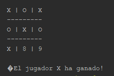

# ⚖️ Tres en Raya - Java

Bienvenido al repositorio de **Tres en Raya**, un juego clásico implementado en **Java**. Este proyecto es una versión sencilla del popular juego de mesa, ideal para aprender sobre lógica de programación, estructuras de datos y desarrollo de interfaces en Java.

## ✨ Características

- Juego simple de **Tres en Raya** en consola.
- Implementado en **Java** con arquitectura modular separada en clases (`Tablero`, `Juego`, `TresEnRaya`).
- Dos modos de juego: **Jugador vs. Jugador** y **Jugador vs. IA (aleatoria)** (pendiente de implementación).
- Código limpio y bien estructurado, ideal para principiantes en Java.

---

## 🛠 Instalación y Uso

Para ejecutar este proyecto en tu máquina local, sigue estos pasos:

1. **Clona este repositorio**
   ```bash
   git clone https://github.com/tu_usuario/TresEnRaya-Java.git
   ```

2. **Navega al directorio del proyecto**
   ```bash
   cd TresEnRaya-Java
   ```

3. **Compila los archivos Java**
   ```bash
   javac *.java
   ```

4. **Ejecuta el juego**
   ```bash
   java TresEnRaya
   ```

---

## 🎮 Cómo Jugar

1. El **tablero** es una cuadrícula de **3x3**.
2. Los jugadores se turnan para colocar su marca (**X** o **O**).
3. **Gana** el primer jugador en alinear **tres** de sus marcas en fila, columna o diagonal.
4. Si todas las casillas están llenas y nadie ha ganado, el juego termina en **empate**.

---

## 📈 Estructura del Código

El código está organizado en tres clases principales:

- **`Tablero.java`**: Maneja el estado del tablero y la lógica de verificación del ganador.
- **`Juego.java`**: Controla el flujo del juego y la interacción con el usuario.
- **`TresEnRaya.java`**: Es el punto de entrada de la aplicación.

---

## 🖼 Vista Previa del Juego




---

## ✍️ Contribuciones

¡Las contribuciones son bienvenidas! Si deseas mejorar el juego, revisa la [Guía de Contribuciones](CONTRIBUTING.md) y sigue estos pasos:

1. **Haz un fork del repositorio**.
2. **Crea una nueva rama**:
   ```bash
   git checkout -b feature-nueva

---

## 🗃️ Licencia

Este proyecto está bajo la licencia **MIT**. Puedes usarlo libremente, pero no olvides dar crédito a los autores originales.

---

¡¡Espero que disfrutes del juego y te entretenga!! 📚🚀

